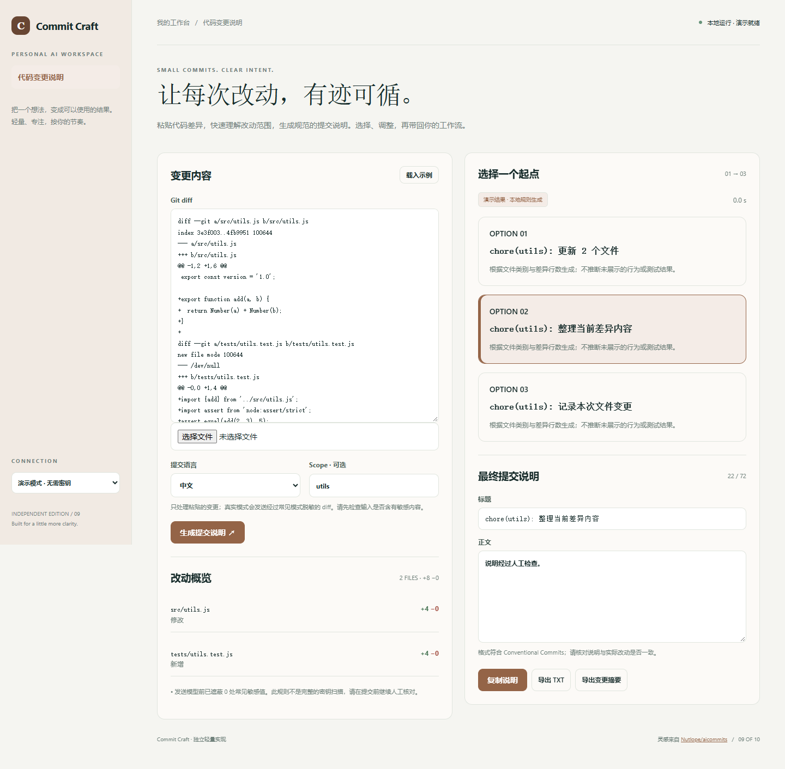

# Commit Craft

粘贴代码差异，快速理解改动范围，生成规范的提交说明。选择、调整，再带回你的工作流。

- 解析 Git diff，显示文件变化与增删行数
- 生成 3 个 Conventional Commits 候选，支持中英文与自定义 scope
- 提交说明可编辑、复制与导出
- 常见密钥样式脱敏，提交前人工检查提示



## 快速开始

需要 Node.js 24 或更新版本；无第三方运行依赖，无需 npm install。

```sh
git clone https://github.com/Yiwen-Yang-BA/chatgpt-commit-craft.git
cd chatgpt-commit-craft
npm start
```

打开 http://127.0.0.1:3109 。默认进入**演示模式**，不调用 API，界面会明确标识规则生成的演示结果。

### 接入真实模型

复制 `.env.example` 为 `.env`，填写 `OPENAI_API_KEY`，按账号权限设置 `OPENAI_MODEL`，然后重启服务并切换界面中的「真实模型」。`OPENAI_BASE_URL` 必须支持 OpenAI Responses API；仅兼容 Chat Completions 的服务不适用。密钥只在服务端读取，不写入前端或仓库。

```sh
# Docker（可选；必须显式传入配置）
docker build -t chatgpt-commit-craft .
docker run --rm -p 127.0.0.1:3109:3109 --env-file .env chatgpt-commit-craft
```

## 使用方法

1. 粘贴 git diff 输出，或导入 .diff / .patch 文件。
2. 选择说明语言，填写可选的 scope，点击生成。
3. 检查文件统计和脱敏提示，选择候选并编辑标题与正文。
4. 复制或导出 commit-message.txt；本工具不会执行 Git 命令或提交代码。

## 验证

```sh
npm run check
npm test
```

测试覆盖业务规则以及本地 HTTP 服务、模拟模型接口、输入校验和错误处理。真实付费模型调用需要用户配置有效密钥，未将演示测试作为真实模型质量验证。GitHub Actions 在每次推送时运行检查。

## 参考与复刻范围

灵感来自 [Nutlope/aicommits](https://github.com/Nutlope/aicommits)（MIT）。查询快照：2026-10-04；9,104 stars；最近推送 2026-09-05。这是当前星标量与更新状态，**不是近一个月新增星标排名**。

本仓库是对其核心交互和用途的独立轻量实现，未复制上游源码、商标或静态资源，不声称实现上游的全部功能，也不属于上游官方产品。

复刻 aicommits 的 diff → 提交信息核心用途，采用独立网页交互。不会读取本机 Git 仓库、安装 hook 或执行提交。支持标准 Git unified diff；统计基于提供的文本，不代表完整仓库状态。常见密钥模式的脱敏不是完整的秘密扫描，请在发送真实模型前自行检查输入。

## 数据与部署边界

输入 diff 和输出只保留在当前页面，不存入浏览器本地；生成结果可导出。 演示模式数据不离开本机；真实模式会将本次输入发送至所配置的模型服务。

默认只监听 127.0.0.1，适用于单人本地使用；没有多用户登录或持久数据库。如需公网部署，请先增加身份验证、配额和 HTTPS。服务限制请求大小、并发和超时，禁止从静态目录读取密钥文件。

接口实现依据 [OpenAI 官方文本生成文档](https://developers.openai.com/api/docs/guides/text)。

## License

MIT — independent implementation.
